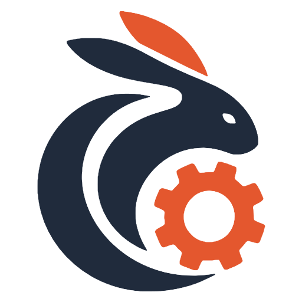

<p align="center">
  <picture>
    <source media="(prefers-color-scheme: dark)" srcset="assets/icone/icon-dark.svg">
    
  </picture>
</p>

<h1 align="center">Module Work Plan</h1>

<p align="center"><strong>Modular documentation for AI agents: every task loads only the context it needs.</strong></p>

<p align="center">
  <a href="LICENSE"></a>
  
</p>

<p align="center"><strong>English</strong> · <a href="README.pt-BR.md">Português (Brasil)</a></p>

---

**Module Work Plan (MWP)** is a documentation format for building software with AI agents. Instead of handing the agent a pile of documents for every small change, MWP describes the system **by module** (how it is today) and records each change in a small, immutable **task** that states exactly which modules the agent needs to read.

MWP is made for systems with a long life, real business rules and work that can be delegated. It is not worth it for a prototype or a throwaway script.

## How it works

| | Module | Task |
|---|---|---|
| Describes | How a part of the system works **today** | What **changes**, in one small unit |
| Contains | Rules (`FR-01`, `NFR-01`), the tests that guard them, contracts, pitfalls | Goal, scope, acceptance criteria, the modules it may read and write |
| Lifetime | Updated with every change, never accumulates history | Immutable once done |

**Born in the task, lives in the module.** Anything still true after a task closes is written into the module before the task is done.

To execute a task, the agent reads the **constitution**, the **task** and the **modules the task lists**, usually 1 to 3. Every acceptance criterion says how it is verified (`[auto: TEST-0007]`, `[manual]`, `[regression]`, `[doc]`), and the task closes only with evidence for each one.

When sources disagree, the priority is **constitution > accepted ADRs > module > task**. If a task contradicts a rule, the agent stops and asks instead of resolving it silently.

```
mwp/
├── PROJECT.md        # short overview: stack, commands
├── constitution.md   # agent rules: what to read, what is allowed, when to stop
├── map.md            # generated index of modules
├── glossary.md       # domain terms (optional)
├── modules/          # the system as it is today
├── tasks/open/       # T-0043-order-discount.md
├── tasks/done/       # finished tasks, never edited
├── specs/            # SP-0003: specs too big for a module
├── decisions/        # ADR-0002: why a choice was made
└── content/          # optional: icons, images, design files, documents
```

## Quick start

Install the CLI from a checkout of this repository (requires [Rust](https://rustup.rs)) and set up your project in one step:

**Linux/macOS**
```bash
./src/install.sh path/to/your-project
```

**Windows (PowerShell)**
```powershell
.\src\install.ps1 path\to\your-project
```

Both scripts install `mwp` with `cargo install` and run `mwp init` in the folder, which asks which agents you use (Claude Code by default; also Codex, Cursor, Gemini CLI and GitHub Copilot) and creates `mwp/`, `AGENTS.md`, each agent's instruction file and skills, without overwriting anything. Leave the folder out to only install the CLI.

1. Fill `mwp/PROJECT.md` and replace the `<placeholders>` in `mwp/constitution.md`.
2. Check `.gitignore`: `init` adds `.mwp/*` and `!.mwp/ledger.json`. The ledger is versioned, the rest of `.mwp/` is local.
3. Document the module you will touch first (copy `mwp/modules/_template.md`, or ask your agent to use the `module` skill on existing code), then run `mwp remap`.
4. Create a task: `mwp task new "Order discount" --modules order`.
5. Ask your agent: *"Execute task T-0001"*.

See the **[guide](assets/docs/guide.md)** for the full workflow, the skills and every CLI option, and **[the philosophy](assets/docs/philosophy.md)** for who does what, and why.

## CLI

| Command | What it does |
|---|---|
| `mwp init [--agent a,b]` | Creates the `mwp/` structure and the files of each agent; never overwrites |
| `mwp task new` / `mwp task-list` | Creates a task with the next ID / lists tasks |
| `mwp task start` / `close` / `release` | Claims a task and locks its modules for one agent / closes it and runs lint / gives it back |
| `mwp locks` | Tasks in progress, their agents and locked modules |
| `mwp context T-0001` | Files the agent will read for a task, with a token estimate |
| `mwp next <T\|SP\|ADR\|TEST>` | Next free ID, optionally reserved in `.mwp/ledger.json` |
| `mwp adr new` / `mwp adr list` | Creates a proposed ADR (optionally superseding one) / lists ADRs |
| `mwp remap` | Rechecks modules and regenerates `map.md` |
| `mwp map` | Prints, writes or checks the module map |
| `mwp lint` | Checks the whole project; exit code 1 on errors |

The CLI is optional: everything it does can be done by hand following the templates.

## Board (GUI)

`mwp-gui` is an optional desktop window for the person following the work. It shows the tasks by status, which agent holds each task in progress, the locked modules and the lint result, and follows the project as agents change it. It is read-only.

```bash
cargo install --path src/gui --locked
```

Run `mwp-gui` inside a project, or `mwp-gui path/to/your-project`.

## Repository

| Path | Contents |
|---|---|
| [`templates/`](templates) | Files `mwp init` copies into a project |
| [`src/client/`](src/client) | The `mwp` CLI and its core library (Rust, no dependencies, no git needed) |
| [`src/gui/`](src/gui) | `mwp-gui`, the optional board (Rust, egui), built on the core library |
| [`src/skill/mwp/`](src/skill/mwp) | Agent skill: the workflow, the CLI and resources in `content/` |
| [`src/skill/module/`](src/skill/module) | Agent skill: create modules from existing code, or audit them against the code and ADRs |
| [`src/install.sh`](src/install.sh), [`src/install.ps1`](src/install.ps1) | Installers for macOS/Linux and Windows |
| [`assets/docs/`](assets/docs) | Guide and philosophy, in English and Brazilian Portuguese |

## License

[Apache 2.0](LICENSE)
