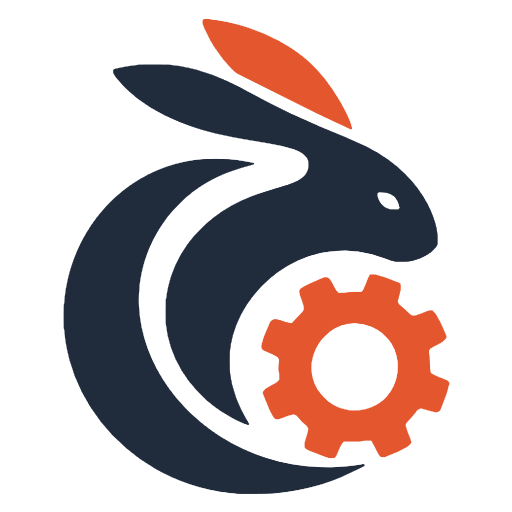

<p align="center">
  <picture>
    <source media="(prefers-color-scheme: dark)" srcset="assets/icone/icon-dark.svg">
    
  </picture>
</p>

<h1 align="center">Module Work Plan</h1>

<p align="center"><strong>Modular documentation for AI agents: every task loads only the context it needs.</strong></p>

<p align="center">
  <a href="LICENSE"></a>
  
</p>

---

**Module Work Plan (MWP)** is a documentation format for building software with AI agents. Instead of handing the agent a pile of documents for every small change, MWP describes the system **by module** (how it is today) and records each change in a small, immutable **task** that states exactly which modules the agent needs to read.


## How it works

| | Module | Task |
|---|---|---|
| Describes | How a part of the system works **today** | What **changes**, in one small unit |
| Contains | Rules (`FR-01`, `NFR-01`), the tests that guard them, contracts, pitfalls | Goal, scope, acceptance criteria, the modules it may read and write |
| Lifetime | Updated with every change, never accumulates history | Immutable once done |

**Born in the task, lives in the module.** Anything still true after a task closes is written into the module before the task is done.

To execute a task, the agent reads the **constitution**, the **task** and the **modules the task lists**, usually 1 to 3. Every acceptance criterion says how it is verified (`[auto: TEST-0007]`, `[manual]`, `[regression]`, `[doc]`), and the task closes only with evidence for each one.

```
mwp/
├── PROJECT.md        # short overview: stack, commands
├── constitution.md   # agent rules: what to read, what is allowed, when to stop
├── map.md            # generated index of modules
├── glossary.md       # domain terms (optional)
├── modules/          # the system as it is today
├── tasks/open/       # T-0043-order-discount.md
├── tasks/done/       # finished tasks, never edited
├── specs/            # SP-0003: specs too big for a module
├── decisions/        # ADR-0002: why a choice was made
└── content/          # optional: icons, images, design files, documents
```

## Quick start

Install the CLI from a checkout of this repository (requires [Rust](https://rustup.rs)) and set up your project in one step:

**Linux/macOS**
```bash
./src/install.sh path/to/your-project
```

**Windows (Powershell)**
```powershell
.\src\install.ps1 path\to\your-project
```

Both scripts install `mwp` with `cargo install` and run `mwp init` in the folder, which creates `mwp/`, `AGENTS.md`, `CLAUDE.md` and the agent skills without overwriting anything. Leave the folder out to only install the CLI.

1. Fill `mwp/PROJECT.md` and replace the `<placeholders>` in `mwp/constitution.md`.
2. Document the module you will touch first (copy `mwp/modules/_template.md`, or ask your agent to use the `module` skill on existing code), then run `mwp remap`.
3. Create a task: `mwp task new "Order discount" --modules order`.
4. Ask your agent: *"Execute task T-0001"*.

See the **[guide](assets/docs/guide.md)** for the full workflow, the skills and every CLI option, and **[the philosophy](assets/docs/philosophy.md)** for who does what, and why.

## CLI

| Command | What it does |
|---|---|
| `mwp init` | Creates the `mwp/` structure; never overwrites |
| `mwp task new` / `mwp task-list` | Creates a task with the next ID / lists tasks |
| `mwp context T-0001` | Files the agent will read for a task, with a token estimate |
| `mwp next <T\|SP\|ADR\|TEST>` | Next free ID, optionally reserved in `.mwp/ledger.json` |
| `mwp adr new` / `mwp adr list` | Creates a proposed ADR (optionally superseding one) / lists ADRs |
| `mwp remap` | Rechecks modules and regenerates `map.md` |
| `mwp map` | Prints, writes or checks the module map |
| `mwp lint` | Checks the whole project; exit code 1 on errors |

The CLI is optional: everything it does can be done by hand following the templates.

## Example

**[The Black Ledger](examples/pirate-ship)** is a working management system for a pirate ship, in Python, Angular and SQLite, documented from end to end in MWP, by a drunk pirate. The domain is absurd on purpose: the format shapes the structure of the work, not its tone.

It has 8 modules, an ADR (all money is stored as whole reales), 7 finished tasks with their evidence, and 5 open tasks that test an agent: some contradict a decision or a registered test, and the agent has to stop and ask.

## Repository

| Path | Contents |
|---|---|
| [`templates/`](templates) | Files `mwp init` copies into a project |
| [`src/client/`](src/client) | The `mwp` CLI (Rust, no dependencies) |
| [`src/skill/mwp/`](src/skill/mwp) | Agent skill: the workflow, the CLI and resources in `content/` |
| [`src/skill/module/`](src/skill/module) | Agent skill: create modules from existing code, or audit them against the code and ADRs |
| [`src/install.sh`](src/install.sh), [`src/install.ps1`](src/install.ps1) | Installers for macOS/Linux and Windows |
| [`assets/docs/`](assets/docs) | Guide and philosophy |
| [`examples/pirate-ship/`](examples/pirate-ship) | A complete project built with MWP, with exercises for agents |

## License

[Apache 2.0](LICENSE)
