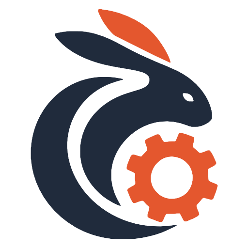

<p align="center">
  <picture>
    <source media="(prefers-color-scheme: dark)" srcset="assets/icone/icon-dark.svg">
    
  </picture>
</p>

<h1 align="center">Module Work Plan</h1>

<p align="center"><strong>Documentação modular para agentes de IA: cada task carrega só o contexto de que precisa.</strong></p>

<p align="center">
  <a href="LICENSE"></a>
  
</p>

<p align="center"><a href="README.md">English</a> · <strong>Português (Brasil)</strong></p>

---

**Module Work Plan (MWP)** é um formato de documentação para construir software com agentes de IA. Em vez de entregar ao agente uma pilha de documentos a cada pequena mudança, o MWP descreve o sistema **por módulo** (como ele é hoje) e registra cada mudança em uma **task** pequena e imutável, que diz exatamente quais módulos o agente precisa ler.

O MWP foi feito para sistemas de vida longa, com regras de negócio reais e trabalho que pode ser delegado. Não vale a pena para um protótipo ou um script descartável.

## Como funciona

| | Módulo | Task |
|---|---|---|
| Descreve | Como uma parte do sistema funciona **hoje** | O que **muda**, em uma unidade pequena |
| Contém | Regras (`FR-01`, `NFR-01`), os testes que as protegem, contratos, armadilhas | Objetivo, escopo, critérios de aceite, os módulos que pode ler e escrever |
| Vida útil | Atualizado a cada mudança, nunca acumula histórico | Imutável depois de concluída |

**Nasce na task, vive no módulo.** Tudo o que continua verdadeiro depois que a task termina é escrito no módulo antes de ela ser concluída.

Para executar uma task, o agente lê a **constituição**, a **task** e os **módulos que a task lista**, normalmente de 1 a 3. Cada critério de aceite diz como é verificado (`[auto: TEST-0007]`, `[manual]`, `[regression]`, `[doc]`), e a task só é concluída com evidência de cada um.

Quando as fontes discordam, a prioridade é **constituição > ADRs aceitos > módulo > task**. Se uma task contradiz uma regra, o agente para e pergunta em vez de resolver em silêncio.

```
mwp/
├── PROJECT.md        # visão geral curta: stack, comandos
├── constitution.md   # regras do agente: o que ler, o que é permitido, quando parar
├── map.md            # índice de módulos gerado
├── glossary.md       # termos do domínio (opcional)
├── modules/          # o sistema como ele é hoje
├── tasks/open/       # T-0043-order-discount.md
├── tasks/done/       # tasks concluídas, nunca editadas
├── specs/            # SP-0003: especificações grandes demais para um módulo
├── decisions/        # ADR-0002: por que uma escolha foi feita
└── content/          # opcional: ícones, imagens, arquivos de design, documentos
```

## Início rápido

Instale o CLI a partir de um clone deste repositório (requer [Rust](https://rustup.rs)) e configure seu projeto em um único passo:

**Linux/macOS**
```bash
./src/install.sh caminho/do/seu-projeto
```

**Windows (PowerShell)**
```powershell
.\src\install.ps1 caminho\do\seu-projeto
```

Os dois scripts instalam o `mwp` com `cargo install` e rodam `mwp init` na pasta, que pergunta quais agentes você usa (Claude Code por padrão; também Codex, Cursor, Gemini CLI e GitHub Copilot) e cria `mwp/`, `AGENTS.md`, o arquivo de instruções e as skills de cada agente, sem sobrescrever nada. Omita a pasta para instalar apenas o CLI. Acrescente `--gui` (no Windows, `-Gui`) para instalar também o [editor](#editor-gui), `mwp-gui`.

1. Preencha `mwp/PROJECT.md` e substitua os `<placeholders>` em `mwp/constitution.md`.
2. Confira o `.gitignore`: o `init` adiciona `.mwp/*` e `!.mwp/ledger.json`. O ledger é versionado, o resto de `.mwp/` é local.
3. Documente o módulo que você vai mexer primeiro (copie `mwp/modules/_template.md`, ou peça ao agente para usar a skill `module` no código existente) e rode `mwp remap`.
4. Crie uma task: `mwp task new "Order discount" --modules order`.
5. Peça ao agente: *"Execute a task T-0001"*.

Veja o **[guia](assets/docs/guide.pt-BR.md)** para o fluxo completo, as skills e todas as opções do CLI, e **[a filosofia](assets/docs/philosophy.pt-BR.md)** para entender quem faz o quê, e por quê.

## CLI

| Comando | O que faz |
|---|---|
| `mwp init [--agent a,b]` | Cria a estrutura `mwp/` e os arquivos de cada agente; nunca sobrescreve |
| `mwp task new` / `mwp task-list` | Cria uma task com o próximo ID / lista as tasks |
| `mwp task start` / `close` / `release` | Reserva uma task e bloqueia seus módulos para um agente / fecha e roda o lint / devolve |
| `mwp locks` | Tasks em andamento, seus agentes e módulos bloqueados |
| `mwp context T-0001` | Arquivos que o agente vai ler em uma task, com estimativa de tokens |
| `mwp next <T\|SP\|ADR\|TEST>` | Próximo ID livre, com reserva opcional em `.mwp/ledger.json` |
| `mwp adr new` / `mwp adr list` | Cria um ADR proposto (podendo substituir outro) / lista os ADRs |
| `mwp module new` / `mwp module folder` | Cria um módulo (podendo ser numa subpasta) e atualiza o `map.md` / cria uma pasta para módulos |
| `mwp spec new` | Cria uma SPEC ativa, com um módulo ou uma task como dono |
| `mwp delete <id>` | Apaga um módulo, uma SPEC, uma task não concluída ou um arquivo de content, depois de confirmar (`--yes` pula a pergunta) |
| `mwp content add` / `mwp content folder` | Copia arquivos para `mwp/content/` sem substituir nenhum / cria uma pasta lá |
| `mwp remap` | Reverifica os módulos e regenera o `map.md` |
| `mwp map` | Imprime, grava ou confere o mapa de módulos |
| `mwp lint` | Verifica o projeto inteiro; código de saída 1 se houver erros |

O CLI é opcional: tudo o que ele faz pode ser feito à mão seguindo os templates.

## Editor (GUI)

O `mwp-gui` (versão 0.1.3) é um editor de desktop opcional para a pessoa que acompanha o trabalho:

- **Explorador** dos arquivos de `mwp/` por seção (projeto, módulos com suas subpastas, SPECs, ADRs e, por último, as tasks divididas em abertas e concluídas; o botão direito em Modules ou numa pasta cria ali um módulo ou uma pasta), com arquivos quebrados em vermelho, e os agentes trabalhando com os módulos que bloqueiam. **Renomeie** um arquivo ou pasta (botão direito, ou F2 para o arquivo aberto; um módulo mantém o ID) e arraste arquivos e pastas para outra pasta de Modules ou de Content para movê-los; ADRs e tasks concluídas ficam como estão.
- **Editor de Markdown** com abas: código com destaque e números de linha, barra de formatação (títulos, negrito, itálico, código, listas, checklists, citações, links) e preview ao vivo, lado a lado ou sozinho. O front matter aparece como tabela de propriedades no preview.
- As abas podem ser arrastadas para a esquerda e a direita (ou botão direito numa aba: Move left, Move right, Close, Close others, Close to the right). Ctrl+W fecha a aba aberta; Ctrl+Tab / Ctrl+Shift+Tab e Ctrl+PageDown / Ctrl+PageUp trocam de aba. Fechar várias abas com alterações não salvas pergunta uma vez só.
- **IDs clicáveis:** no preview, `T-0007`, `SP-0001`, `ADR-0002` e IDs de módulos escritos como código (`` `order` ``, `` `order#FR-01` ``) são links para os seus arquivos, assim como os IDs na tabela do front matter (modules, refs, owner...). No código, Ctrl+clique num ID. IDs que não existem continuam como texto.
- **Edit > Find** (Ctrl+F): uma barra de busca com diferenciação de maiúsculas, contador "n of m", todas as ocorrências destacadas, Enter / F3 para a próxima e Shift para a anterior; o Esc deixa a ocorrência selecionada. **Edit > Replace** (Ctrl+H) acrescenta uma linha de substituição: Replace (a ocorrência atual, depois a próxima) e Replace all, desfeito com um único Ctrl+Z.
- **Edit > Find in project** (Ctrl+Shift+F): a aba Search do painel inferior lista todas as ocorrências nos arquivos de texto de `mwp/` (abas abertas como estão no editor), por arquivo e linha; um clique abre o arquivo com a ocorrência selecionada. O **Replace all…** dali substitui todas as ocorrências depois de perguntar: arquivos fechados são gravados, arquivos abertos numa aba mudam na aba e ficam sem salvar.
- **File > Go to file** (Ctrl+P): digite parte do nome, do ID ou do título de um arquivo, escolha com as setas, Enter abre.
- **File > Save / Save all** (Ctrl+S / Ctrl+Shift+S), os comandos padrão do **Edit** (desfazer, refazer, recortar, copiar, colar, selecionar tudo) e um aviso antes de perder alterações não salvas. Quando um agente altera um arquivo que você está editando, uma barra pergunta se fica a sua edição ou a versão do disco; o salvamento espera a resposta, para nenhuma das duas se perder, e **Show changes** lista as linhas que diferem. Um arquivo apagado no disco ganha uma barra com **Save again** e **Close tab**; o Ctrl+S nunca o recria sozinho.
- **Content**: os recursos de `mwp/content/` com suas pastas. Adicione arquivos pelo **+**, pelo botão direito numa pasta ou arrastando-os para a janela (um arquivo existente nunca é substituído); o botão direito num arquivo abre no app dele, mostra na pasta, copia o caminho para citar numa task ou apaga.
- **Context** no cabeçalho de uma task: o que um agente carrega para a task (constituição, task, módulos, SPECs, ADRs e tasks citados), com a estimativa de tokens e os IDs citados que não existem em vermelho, como o `mwp context`.
- **Quadro** das tasks por status; um cartão abre a task. **Start**, **Status** e **Close** (cabeçalho da task, ou botão direito num cartão) fazem o mesmo que `mwp task start`, `release` e `close`: reserva e locks dos módulos, a mudança para `tasks/done/`, a conferência do `## Closure`. Arrastar um cartão para outra coluna faz o mesmo: In progress abre o Start, Open / Blocked / Review fazem o release, Done faz o Close; a coluna que aceita o cartão fica destacada. Filtros acima das colunas mostram só os cartões por título, ID ou código de trabalho, módulo, agente e tamanho.
- **Accept** e **Reject** no cabeçalho de um ADR proposto definem o seu status (só uma pessoa decide um ADR, por isso o CLI não tem esse comando).
- **File > Project agents** adiciona agentes ao projeto aberto (o arquivo de instruções e as skills, como o `mwp init --agent`) e atualiza as skills dos agentes já configurados (como o `mwp init --update-skills`); arquivos existentes nunca são sobrescritos.
- **Problemas** do `mwp lint`; uma linha abre o arquivo. Um `map.md` desatualizado ganha o botão **Update map.md**, como o `mwp remap`.
- **New task**, **New module**, **New SPEC** e **New ADR** (menu File, o **+** da seção no explorador, o quadro) criam o arquivo a partir do template com o próximo ID livre; um módulo novo entra no `map.md`, uma SPEC recebe um módulo ou uma task como dono e um ADR pode substituir outro em vigor.
- **Delete** (cabeçalho do arquivo, botão direito no explorador ou num cartão, menu File) apaga um módulo, uma SPEC ou uma task aberta depois de confirmar; os locks da task são liberados e o `map.md` acompanha os módulos.
- **File > New project** cria um projeto (pasta, nome, agentes, skills), como o `mwp init`. **File > Open project** procura a pasta ou reabre um dos 5 projetos recentes, que também aparecem na tela inicial.
- **Settings > Preferences** define o tema (escuro, claro ou o do sistema), o tamanho do texto (de 80% a 160%) e a fonte do texto (qualquer arquivo TrueType ou OpenType; o editor de código mantém a sua fonte monoespaçada), tudo aplicado na hora e lembrado. Também escolhe o idioma da GUI: inglês, português do Brasil, espanhol, japonês e coreano vêm junto (japonês e coreano usam as fontes do sistema). Cada idioma é um arquivo JSON em `<config>/mwp-gui/lang/` (no Windows, `%APPDATA%\mwp-gui\lang\`) que liga os textos em inglês à sua tradução; para outro idioma, copie o `en.json` para `<código>.json` e traduza, e um texto que faltar no arquivo fica em inglês. As mensagens do core (linhas do lint, erros) continuam em inglês.
- **Help > About** mostra a arte do projeto, as versões da GUI e do core, e a licença.
- A GUI volta como foi deixada: tamanho e posição da janela, largura do explorador, altura do painel inferior, seções recolhidas, modo do editor, e as abas abertas e os filtros do quadro de cada projeto. O estado fica em `<config>/mwp-gui/` (no Windows, `%APPDATA%\mwp-gui\`); se o arquivo estiver danificado, a GUI abre com o padrão.

Ele relê o projeto a cada 2 segundos, então acompanha o que os agentes alteram.

Instale com a opção `--gui` / `-Gui` do instalador. O instalador também coloca o `templates.tar.zst` ao lado do `mwp` e do `mwp-gui`: os dois leem dele os templates do `mwp init` e das novas tasks, módulos, SPECs e ADRs. Um `cargo install --path src/gui --locked` sozinho deixa esse arquivo na pasta do build (`target/release/`), então copie-o para o lado do binário.

Rode `mwp-gui` dentro de um projeto, ou `mwp-gui caminho/do/seu-projeto`. O que mudou em cada versão está no [CHANGELOG](src/gui/CHANGELOG.md).

## Repositório

| Caminho | Conteúdo |
|---|---|
| [`templates/`](templates) | Arquivos que o `mwp init` copia para um projeto |
| [`src/client/`](src/client) | O CLI `mwp` e sua biblioteca core (Rust, sem dependências, não precisa do git) |
| [`src/gui/`](src/gui) | O `mwp-gui`, o editor opcional (Rust, egui), feito sobre a biblioteca core |
| [`src/skill/mwp/`](src/skill/mwp) | Skill do agente: o fluxo de trabalho, o CLI e os recursos em `content/` |
| [`src/skill/module/`](src/skill/module) | Skill do agente: cria módulos a partir do código existente ou os audita contra o código e os ADRs |
| [`src/install.sh`](src/install.sh), [`src/install.ps1`](src/install.ps1) | Instaladores para macOS/Linux e Windows |
| [`assets/docs/`](assets/docs) | Guia e filosofia, em inglês e português do Brasil |

## Licença

[Apache 2.0](LICENSE)
