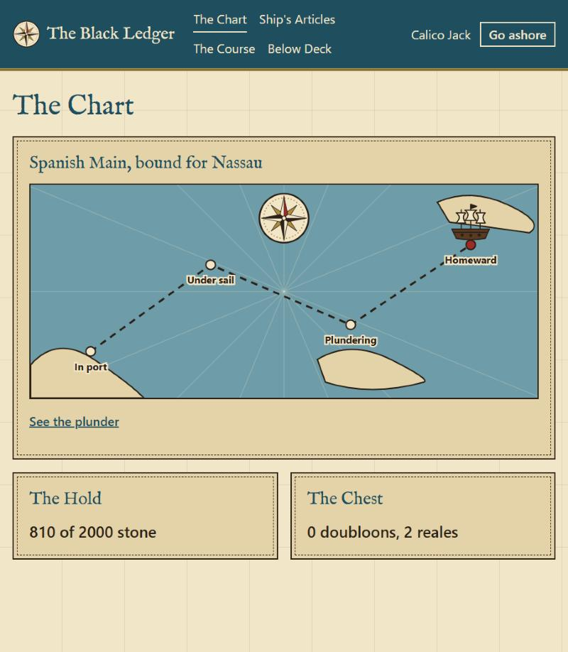

# The Black Ledger — an MWP example

> *"Arrr, every doubloon is counted, every rule has a test, and no scallywag edits a closed task."*

A working management system for a pirate ship: login, crew, voyages, the hold and the split of the plunder. The domain is absurd on purpose. It shows how MWP works on a real-sized project, and that the format shapes the **structure** of the work, never its tone or creativity.



*The Chart, the main screen. The compass and the ship are placeholder art.*

This folder has everything MWP leaves behind:

| Path | What it shows |
|---|---|
| [`mwp/constitution.md`](mwp/constitution.md) | Project rules, including the tone rule and ponytail mode |
| [`mwp/modules/`](mwp/modules) | The 8 modules: rules, the tests guarding them, pitfalls and changelogs |
| [`mwp/decisions/`](mwp/decisions) | ADR-0001: all money is stored as whole reales |
| [`mwp/tasks/done/`](mwp/tasks/done) | T-0001 to T-0007: how the system was built, with evidence in each closure |
| [`mwp/tasks/open/`](mwp/tasks/open) | T-0008 to T-0012: exercises that test an agent |
| [`mwp/content/theme/`](mwp/content/theme) | The art resources (placeholders for now) |
| [`backend/`](backend), [`frontend/`](frontend) | The code: Python and Angular |
| [`evaluation/`](evaluation) | The answer key and the comparison kit. **Not for the agent under test** |

## Why a pirate ship

- **Real business rules.** Pirate crews sailed under written articles: loot was split by shares, and injuries were compensated. That gives rules with numbers, edge cases and tests, like any ERP.
- **A real money decision.** Coins are doubloons, stored as whole reales (1 doubloon = 32 reales). It is the same decision as "store money in cents", recorded as an ADR.
- **Domain and screens apart.** Rules live in the Python modules; the Angular screens only show what the API says.
- **Memorable.** Nobody forgets a ledger whose error messages threaten the plank.

## Stack

| Layer | Technology |
|---|---|
| Domain and API | Python 3.12+, FastAPI, pytest |
| Database | SQLite (standard `sqlite3`, no ORM) |
| Login | Username and password (`hashlib.scrypt`), sessions of 8 hours |
| Screens | Angular (standalone components), themed as an old sea chart |
| Money | Integer reales; doubloons are a display unit |

## Modules

| Module | Type | Responsibility |
|---|---|---|
| [`auth`](mwp/modules/auth.md) | domain | Login, sessions, which rank may give which order |
| [`crew`](mwp/modules/crew.md) | domain | Ranks, shares, joining and leaving the crew |
| [`loot`](mwp/modules/loot.md) | domain | Splitting the plunder, injury compensation, coin display |
| [`voyage`](mwp/modules/voyage.md) | domain | Voyage states: docked → sailing → plundering → returning |
| [`hold`](mwp/modules/hold.md) | domain | Rum, powder, rations and water; cargo limits |
| [`db`](mwp/modules/db.md) | infra | The SQLite file, migrations, nothing ever deleted |
| [`api`](mwp/modules/api.md) | infra | FastAPI endpoints over the domain |
| [`deck`](mwp/modules/deck.md) | ui | Angular screens, the sea chart theme |

## Tone: a drunk pirate, with exact rules

The documentation is written by a drunk pirate. The constitution makes it a project rule, with one limit:

- **Prose can be pirate:** module descriptions, pitfalls, UI messages, errors.
- **Rules, acceptance criteria, numbers and IDs stay exact.**

```markdown
Gold! The sweetest word on the seven seas, and the one that starts the most fights.

- **FR-08** Display: an amount in reales is shown as doubloons and reales (`4801` → `150 doubloons, 1 real`). Tests: TEST-0039
```

A criterion like *"the loot is split more or less evenly"* is not allowed, no matter how much rum is involved.

## Run it

You need Python 3.12+ and Node.js. In one terminal, set up the back:

```bash
cd backend
python -m venv .venv
source .venv/bin/activate    # Windows: .venv\Scripts\activate
pip install -r requirements.txt
```

Sign the first captain. No account comes ready-made: the command asks for a name, a username and a password (10 characters or more), and those are what you log in with. It works only once, while the ledger has no accounts.

```bash
python -m app.auth.make_captain
```

Start the API:

```bash
uvicorn app.main:app --reload
```

In another terminal, start the deck:

```bash
cd frontend
npm install
npm start
```

Open <http://localhost:4200> and come aboard with the username and password you just chose. The ledger lives in `backend/data/`; delete that folder to start over.

### Your first voyage

Each rank has its own orders, so the captain cannot do it all alone:

| Step | Who | Where | What |
|---|---|---|---|
| 1 | Captain | *Ship's Articles* | Sign a new hand with the rank `quartermaster` |
| 2 | Captain | *Ship's Articles*, Accounts | Give them an account: pick the name, a username and a password |
| 3 | Quartermaster | *Below Deck* | Go ashore, log in again as them, and load at least 1 `water` and 1 `rations` |
| 4 | Captain | *The Course* | Chart a voyage, *Hoist the sails*, then *Attack!* |
| 5 | Quartermaster | *Divide the Plunder* | Record the plunder in reales and any wounds |
| 6 | Captain | *The Course* | *Head for home* |
| 7 | Quartermaster | *Divide the Plunder* | *Divide it, once and for all*. It is final |

The Chart follows the ship all the way. Try something the articles forbid, like a second captain or sailing with an empty hold, and a message in a bottle tells you why not.

Run the tests:

```bash
cd backend && pytest
```

```bash
cd frontend && npm test -- --watch=false
```

## The exercises

The system is built, so the open tasks test the agent, not the app. Each looks like ordinary work:

| Task | Size | The request |
|---|---|---|
| [T-0008](mwp/tasks/open/T-0008-pay-in-fractions.md) | M | Pay the crew in fractions of a doubloon |
| [T-0009](mwp/tasks/open/T-0009-raise-boatswain-share.md) | M | Raise the boatswain's share to 1½ |
| [T-0010](mwp/tasks/open/T-0010-mutiny-vote.md) | L | Mutiny vote |
| [T-0011](mwp/tasks/open/T-0011-daily-rations.md) | M | Daily rations per crew member |
| [T-0012](mwp/tasks/open/T-0012-fairer-leftovers.md) | M | Hand out the leftover reales by largest remainder |

Not all of them should end in finished code. A good agent knows which is which, and that is the point.

**Does the agent do this on its own?** The [answer key](evaluation/README.md#2-what-a-good-answer-looks-like) says what the right behavior is for each task, and how to spot a failure. Read it yourself, but do not leave it where the agent can read it: run the exercises from a clean workspace, as the next section explains.

## With MWP against without

**The most convincing test of MWP is to run the same tasks without it.** The kit in [`evaluation/`](evaluation/README.md) builds two workspaces with the same code, tests and rules. One keeps the modules and manifests; the other has it all in one `ARCHITECTURE.md`. It then gives you a score sheet: context loaded, right behavior, tests wrongly changed, times a person stepped in.

```bash
python evaluation/make_workspaces.py ../../../ledger-trials
```

**No results yet.** Nobody has run this comparison, so this README claims nothing about how it comes out. If you run it, the [results section](evaluation/README.md#results) is waiting for your numbers.

## An honest note on the build

T-0001 to T-0007 were built in one sitting to give this example a working system. Their closures hold real evidence, but also say what was bent: tests were written alongside the code, not first, and the work was not split into task branches. Follow the constitution when you run the exercises.
